# QA Automation — Detailed Architecture

> App-agnostic pipeline: Scrape website → UI Contract JSON → Test Plan → YAML Testcase → Playwright E2E spec → Run

---

## 1. High-Level System Overview

```mermaid
graph TD
    subgraph UI["React Frontend (port 3000)"]
        A1[Apps Page]
        A2[Extract Contract / NewRunPage]
        A3[App Workspace Page]
        A4[Job Detail Page]
        A5[App Artifacts Page]
    end

    subgraph API["FastAPI Backend (port 8000)"]
        B1["/api/jobs — jobs.py"]
        B2["/api/apps — apps.py"]
        B3["/api/apps/{slug}/... — workspace.py"]
        B4[Health Endpoint]
    end

    subgraph Core["Core Services"]
        C1[job_runner.py\nSingle-worker thread pool]
        C2[artifacts.py\nFile browser + download]
        C3[workspace_edit.py\nManual save plan/testcase]
    end

    subgraph Generators["Generators"]
        D1[test_plan_generator.py]
        D2[testcase_generator.py]
        D3[spec_generator.py]
    end

    subgraph Libs["Library Layer"]
        E1[lib/contract.py\nContract dataclass + slicing]
        E2[lib/intent_extractor.py\nJourney extraction]
        E3[lib/llm.py\nOpenAI gpt-4o-mini]
        E4[lib/workspace.py\nworkspace.json registry]
        E5[lib/playwright_run.py\nPlaywright execution]
        E6[lib/scrape_auth.py\nLogin detection]
        E7[scraper.py\nPlaywright crawler]
    end

    subgraph FS["Filesystem — data/"]
        F1["contracts/{app}-contract.json"]
        F2["output/{app}/workspace.json"]
        F3["output/{app}/tests/testplan/plan-{id}.md"]
        F4["output/{app}/tests/testcases/{id}/case.yaml"]
        F5["output/{app}/tests/scripts/e2e/{id}/case.e2e.spec.ts"]
        F6["output/{app}/tests/scripts/pages/*.ts (POMs)"]
        F7["jobs/{job_id}/status.json + job.log"]
    end

    UI --> API
    API --> Core
    Core --> Generators
    Core --> Libs
    Generators --> Libs
    Libs --> FS
    Core --> FS
```

---

## 2. Intent-Driven Workflow (Step by Step)

```mermaid
flowchart TD
    START([User opens UI]) --> APPS[Apps Page\nLists apps from data/output/]
    APPS --> WS[Workspace Page]

    subgraph STEP0["Step 0 — Extract Contract"]
        S0A[User enters URL + optional auth] --> S0B["POST /api/jobs/scrape"]
        S0B --> S0C[scraper.py\nPlaywright headless crawl]
        S0C --> S0D["Login detection\nlib/scrape_auth.py\nLLM + heuristics"]
        S0D --> S0E["Builds contract v2.0.0 JSON\nper-page: elements, forms, links, inputs\nselectors: playwright + xpath\nregion: header/footer/nav/content"]
        S0E --> S0F["Writes data/contracts/{app}-contract.json"]
        S0F --> S0G[workspace.json created/updated]
    end

    subgraph STEP1["Step 1 — Generate Test Plan"]
        S1A[User types intent\ne.g. 'Verify all nav links'] --> S1B["POST /api/apps/{slug}/generate/plan\nbody: { user_intent }"]
        S1B --> S1C[job_runner: start_job 'plan']
        S1C --> S1D[load_contract → Contract dataclass]
        S1D --> S1E["intent_extractor.extract_journey()\nResolves page sequence\nfrom contract.resolve_target_pages()"]
        S1E --> S1F{"Journey route\nconstruction"}
        S1F --> S1G["_pick_nav_element()\nScores elements by\ntarget_path + label + region"]
        S1G --> S1H{"Ambiguous?\ntied score"}
        S1H -- Yes --> S1I["LLM disambiguate\nintent_journey_disambiguate_prompt"]
        S1H -- No --> S1J
        S1I --> S1J["Journey: page_sequence + route steps\n+ fill actions + assertions"]
        S1J --> S1K["contract.slice_for_journey()\nTrims contract to relevant pages\nfor LLM prompt"]
        S1K --> S1L["test_plan_intent_prompt()\n→ OpenAI gpt-4o-mini\ntemp=0.2, max_tokens=2500"]
        S1L --> S1M["Writes plan-uuid8.md\nwith YAML frontmatter:\nplan_id, user_intent, module,\npage_sequence, route, created_at"]
        S1M --> S1N["workspace.add_plan()\nRegisters in workspace.json"]
    end

    subgraph STEP2["Step 2 — Generate Test Case"]
        S2A["User selects plan from dropdown"] --> S2B["POST /api/apps/{slug}/generate/testcase\nbody: { plan_id }"]
        S2B --> S2C["job_runner: start_job 'testcase'"]
        S2C --> S2D["load plan markdown\nparse_plan_frontmatter()\nExtract journey from frontmatter"]
        S2D --> S2E{"Saved journey\nhas route?"}
        S2E -- Yes --> S2F["Reconstruct Journey\nfrom frontmatter steps"]
        S2E -- No --> S2G["Re-run extract_journey()\nwith LLM"]
        S2F --> S2H
        S2G --> S2H["contract.slice_for_journey()\nSlim contract slice"]
        S2H --> S2I["testcase_yaml_prompt()\n→ OpenAI gpt-4o-mini JSON mode\ntemp=0.0, max_tokens=8000"]
        S2I --> S2J["_extract_flow_from_llm_result()\nHandles wrapped flow/flows/testcase keys"]
        S2J --> S2K["_normalize_flow()\nAdds module, type, tags, actors,\nenvironments, case IDs"]
        S2K --> S2L["contract_validate.validate_flow()\nChecks page_ids + element_ids\nagainst contract"]
        S2L --> S2M["Writes case.yaml\ndata/output/{app}/tests/testcases/{plan_id}/case.yaml"]
        S2M --> S2N["workspace.register_testcases()"]
    end

    subgraph STEP3["Step 3 — Generate Playwright Spec"]
        S3A["User selects plan (optional: LLM toggle)"] --> S3B["POST /api/apps/{slug}/generate/spec\nbody: { plan_id, use_llm_spec }"]
        S3B --> S3C["job_runner: start_job 'spec'"]
        S3C --> S3D["scaffold_app()\nWrites package.json, tsconfig.json,\nplaywright.config.ts, helper TS files\nskips if exists"]
        S3D --> S3E["generate_spec_for_plan()\nLoads case.yaml"]
        S3E --> S3F{"Is nav case?\nmodule=navigation +\nstructured nav_links"}
        S3F -- Yes --> S3G["_emit_nav_case_body()\nFor each home_navigation link:\ngoto('/') → click → URL assert"]
        S3F -- No --> S3H["_emit_deterministic_case_body()\nResolves element_refs → locators\n→ action expressions"]
        S3G --> S3I
        S3H --> S3I{"use_llm_spec OR\ncoverage < 50%?"}
        S3I -- Yes --> S3J["spec_case_prompt() → LLM\ntemp=0.2, max_tokens=2000"]
        S3J --> S3Jb["_sanitize_llm_body()\nStrips invented POM methods\n+ non-contract selectors\nAdds .first() before actions"]
        S3Jb --> S3K
        S3I -- No --> S3K["Assemble test() block"]
        S3K --> S3L["Generate Page Object Models\ngenerate_pom() for each page\nLocator method per element_id"]
        S3L --> S3M["workspace.register_spec()"]
    end

    subgraph STEP4["Step 4 — Play (Run)"]
        S4A["User clicks Play button"] --> S4B["POST /api/apps/{slug}/run/spec\nbody: { plan_id, spec_path }"]
        S4B --> S4C["job_runner: start_job 'run'"]
        S4C --> S4D{"PLAYWRIGHT_HEADED\nenabled?"}
        S4D -- No --> S4E["Error: not enabled\nRequires docker-compose.headed.yml"]
        S4D -- Yes --> S4F["ensure_env_qa()\nWrites .env.qa with QA_UI_BASE_URL"]
        S4F --> S4G["ensure_node_deps()\nnpm install + playwright install chromium\ncached via .deps-installed marker"]
        S4G --> S4H["subprocess: npx playwright test\n--headed --reporter=html,list"]
        S4H --> S4I["Returns exit_code\npassed = exit_code == 0\nreport_path = playwright-report/index.html"]
        S4I --> S4J["Frontend shows Pass/Fail\n+ Show Report button\nserves HTML inline via iframe"]
    end

    WS --> STEP0
    STEP0 --> STEP1
    STEP1 --> STEP2
    STEP2 --> STEP3
    STEP3 --> STEP4
```

---

## 3. Job Runner — Single Worker Model

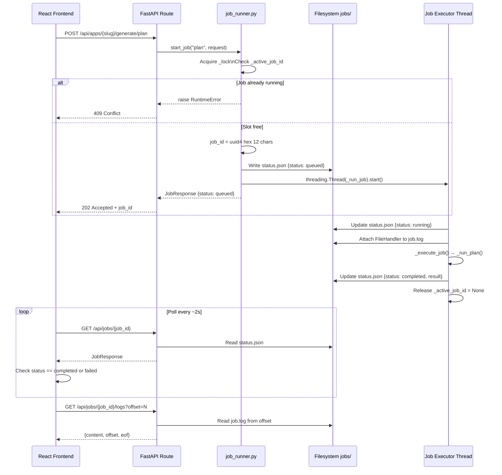

---

## 4. Contract Data Model (v2.0.0)

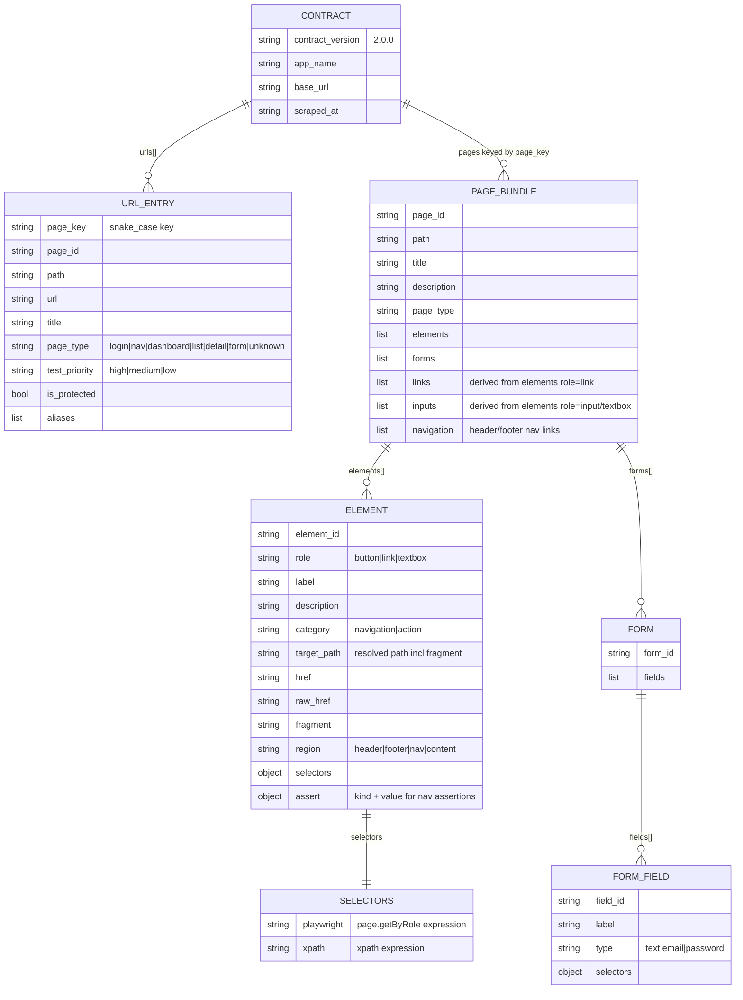

---

## 5. Workspace Registry (workspace.json)

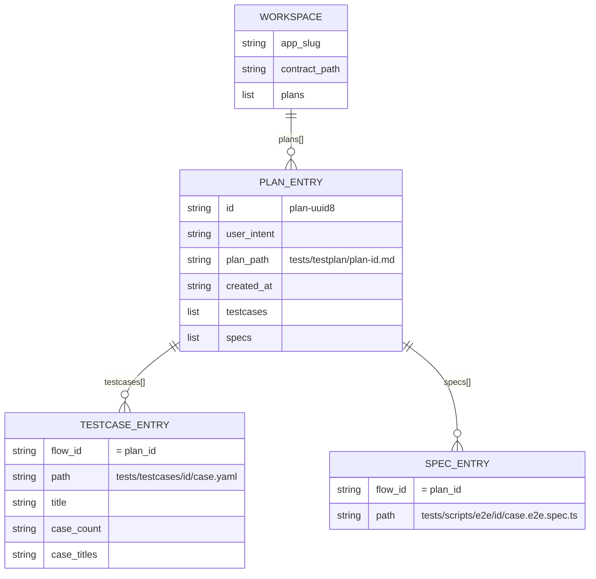

---

## 6. Intent Extractor — Journey Resolution

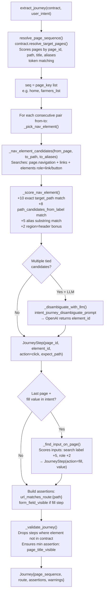

---

## 7. Spec Generator — Deterministic vs LLM Path

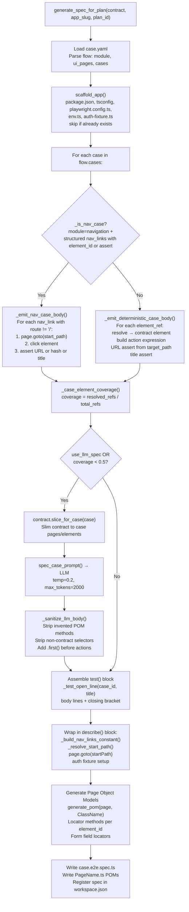

---

## 8. Scraper — Website Crawl & Contract Extraction

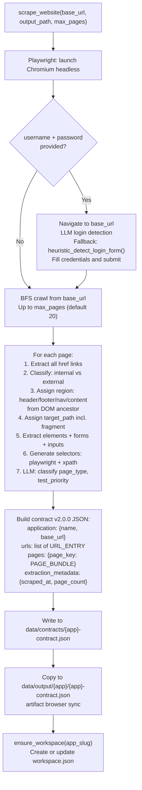

---

## 9. API Route Map

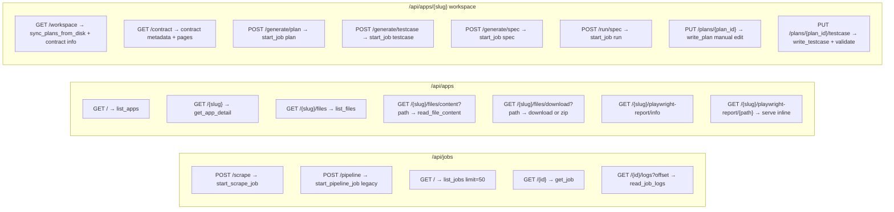

---

## 10. Filesystem Artifact Layout

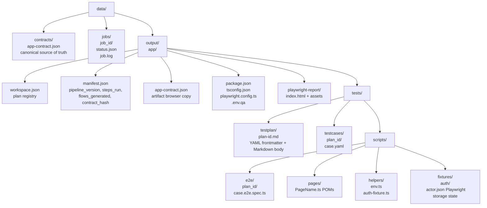

---

## 11. Frontend Component Map

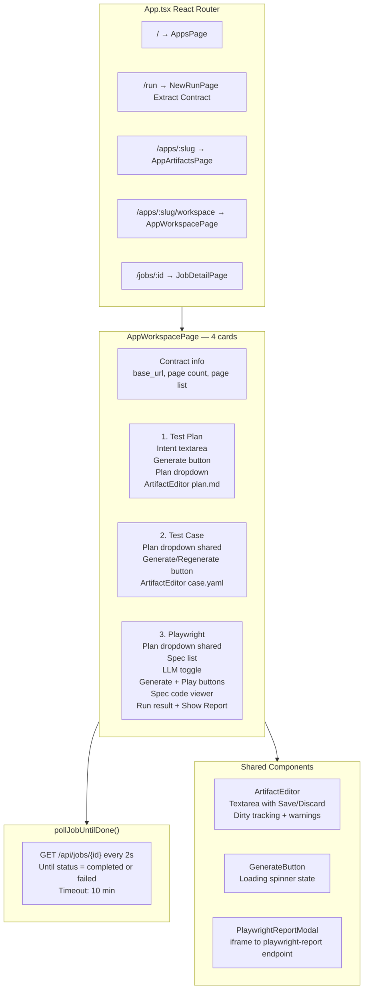

---

## 12. LLM Usage Summary

| Step | Prompt Function | Model | temp | max_tokens | Output |
|------|----------------|-------|------|------------|--------|
| Journey disambiguation | `intent_journey_disambiguate_prompt` | gpt-4o-mini | 0.0 | 500 | `{element_id}` JSON |
| Test Plan | `test_plan_intent_prompt` | gpt-4o-mini | 0.2 | 2500 | Markdown body |
| Test Case | `testcase_yaml_prompt` | gpt-4o-mini | 0.0 | 8000 | JSON flow object |
| Playwright spec body | `spec_case_prompt` / `spec_body_prompt` | gpt-4o-mini | 0.2 | 2000 | TypeScript body |
| Login detection (scrape) | inline | gpt-4o-mini | 0.0 | 300 | JSON login form fields |

---

## 13. Contract Version Compatibility

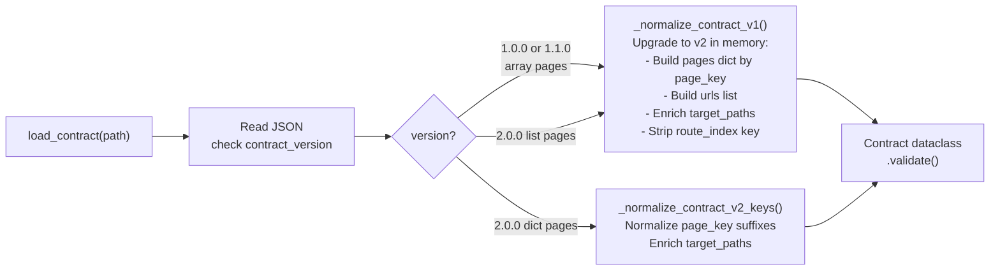
